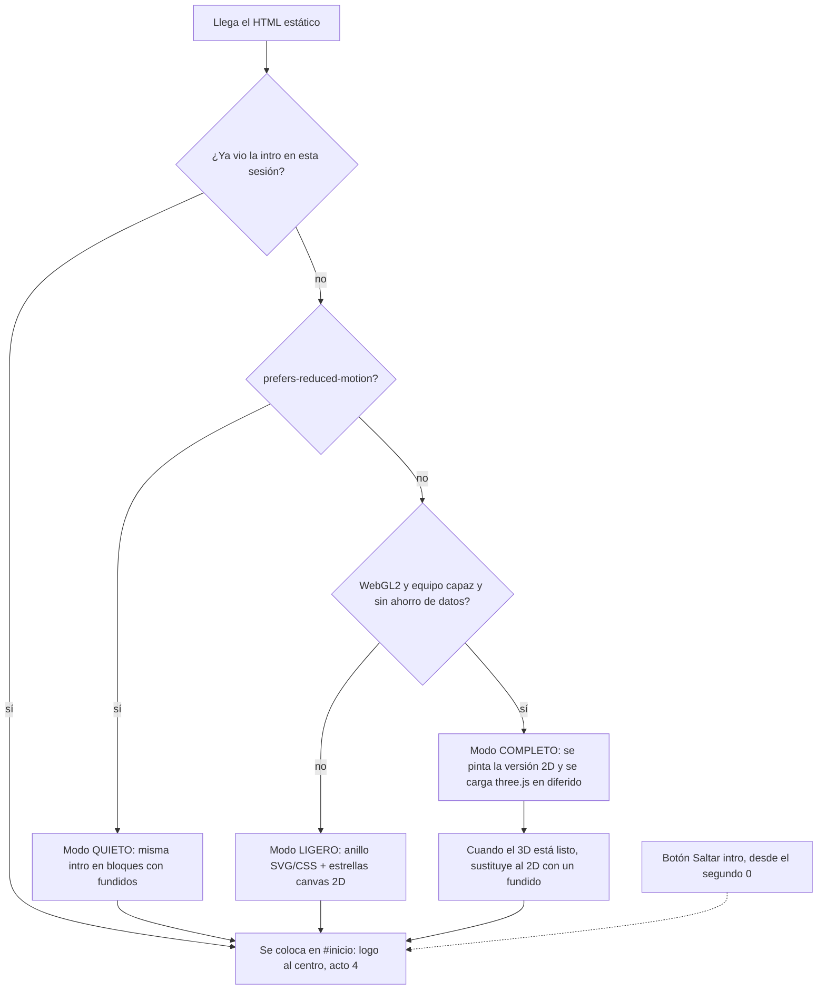

# Arquitectura — Página de presentación de Prodigia

> Estado: **plan aprobable**, sin código todavía. Fecha: 2026-10-10.
> Fuentes: `PROMPT_WEB_PRODIGIA.md` (el encargo) y `FICHA_PRODIGIA.md` (la verdad del producto).
> Proyecto original de referencia (solo lectura): `D:\Repositorios\prodigia\calibra-proyecto\` (`calibra/` = web, `mobile/` = app).

---

## 1. Qué es y qué no es

- **Es** un sitio público, estático en espíritu, que presenta Prodigia: intro guiada por scroll (pluma → anillo → logo) y después un sitio normal con secciones.
- **No es** la app para estudiar. No tiene cuentas, base de datos, formularios ni pagos. Solo enlaza a la web real (`calibra`), a la futura app y a redes.
- Se despliega en **Vercel**. Dominio propio después; la URL base sale de una variable de entorno.

## 2. Dónde vive

El encargo pedía una carpeta `sitio/` dentro del monorepo de Prodigia. El usuario creó un **repositorio aparte** (`D:\Repositorios\Prodigia-web`) dedicado solo a esto, así que:

- **La app Next.js vive en la raíz de este repo** (no en `sitio/`). En Vercel, el directorio raíz es `./`.
- El repo original **nunca se modifica**; solo se lee para verificar datos.
- Todo lo que se descargue o genere (caché de npm, navegadores de prueba, temporales) va al **disco D:** (C: está lleno). Ver `CLAUDE.md`.

## 3. Pila técnica

| Pieza | Elección | Por qué |
|---|---|---|
| Framework | **Next.js (App Router) 16.x** + React 19.2 + TypeScript estricto | Lo pide el encargo; es la misma línea que `calibra` (Next 16.3.0, React 19.2.8). |
| Estilos | **Tailwind CSS 4** + tokens CSS de marca | Igual que `calibra`. Tokens en `app/globals.css` con `@theme`. |
| Componentes base | Estructura **shadcn** (`components/ui`, util `cn`) | Solo lo que se use (botón, quizá `Sheet` no: el menú es propio). Sin instalar todo Radix. |
| Animación | **GSAP 3** + **ScrollTrigger** + `@gsap/react` (`useGSAP`) | Una sola librería de animación para todo el sitio. GSAP ya es gratis con todos sus plugins. |
| 3D | **three.js** + **@react-three/fiber 9** | Lo pide el encargo. Sin `drei` salvo que algo concreto lo justifique (menos peso). Se carga **diferido**. |
| Fuentes | `next/font/google`: Space Grotesk, Inter, JetBrains Mono | Autoalojadas en el build: sin peticiones a Google en runtime, compatible con la CSP. |
| Datos | Archivos TypeScript tipados en `contenido/` | Nada de texto regado por los componentes. |

Versiones: se fijan **exactas** (sin `^`) en `package.json` al instalar, eligiendo versiones publicadas hace más de 2 semanas. `npm audit` debe quedar limpio.

## 4. Árbol de carpetas

```
Prodigia-web/
├─ app/
│  ├─ layout.tsx              # <html lang="es">, fuentes, metadatos base, nonce para scripts
│  ├─ page.tsx                # Intro (actos 1-3) + Sitio (acto 4)
│  ├─ loading.tsx             # Carga de marca (pluma dibujándose)
│  ├─ not-found.tsx           # 404 con estética del sitio y camino de vuelta
│  ├─ error.tsx               # Error de ruta
│  ├─ global-error.tsx        # Error raíz (sin depender del layout)
│  ├─ privacidad/page.tsx     # Aviso de privacidad sencillo
│  ├─ opengraph-image.tsx     # Imagen social generada (logo + fondo de marca)
│  ├─ icon.svg / apple-icon.png
│  ├─ manifest.ts · sitemap.ts · robots.ts
│  └─ globals.css             # Tokens de marca, base, utilidades
├─ proxy.ts                   # (Next 16 = antes "middleware") nonce por petición + CSP
├─ components/
│  ├─ ui/                     # Primitivas shadcn (button…)
│  ├─ marca/                  # Logo (port fiel de Logo.tsx), LogoAnimado, Pluma (SVG)
│  ├─ intro/
│  │  ├─ Intro.tsx            # Orquestador: elige modo (3D / 2D / quieto) y monta la pista de scroll
│  │  ├─ EscenarioFijo.tsx    # El único "pin": contenedor sticky de 100svh
│  │  ├─ TextosIntro.tsx      # TODO el texto de la intro como HTML real (h1, h2, p, listas)
│  │  ├─ FraseTrazada.tsx     # Acto 1: frase revelada al paso de la pluma
│  │  ├─ BotonSaltar.tsx      # Botón gris pequeño, esquina inferior derecha
│  │  ├─ Estrellas.tsx        # Campo de estrellas 2D (canvas) para modo 2D y antes de que llegue el 3D
│  │  ├─ Anillo2D.tsx         # Caída SVG/CSS del anillo
│  │  └─ escena3d/            # Cargado con next/dynamic({ ssr:false }) solo si hay WebGL y equipo capaz
│  │     ├─ Lienzo.tsx        # <Canvas> único (un solo renderer en toda la página)
│  │     ├─ Anillo.tsx        # Anillo con volumen (Lathe de perfil rectangular) + drawRange
│  │     ├─ Ciudades.tsx      # InstancedMesh de edificios + ventanas de neón por mundo
│  │     ├─ Pluma3D.tsx       # Pluma como plano con textura del SVG
│  │     ├─ Particulas.tsx    # Estrellas, tinta, polvo del anillo, destello final (con presupuesto)
│  │     └─ Camara.tsx        # Recorrido de cámara por curva, atado al progreso del scroll
│  └─ sitio/
│     ├─ Encabezado.tsx       # Fijo, aparece al entrar al acto 4
│     ├─ MenuMovil.tsx        # Menú a pantalla completa (reescritura de sterling-gate)
│     ├─ LogoViajero.tsx      # Logo que cambia de lado según la sección (≥1024px)
│     ├─ secciones/           # Una por sección del acto 4 (ver DISENO.md §6)
│     └─ Pie.tsx
├─ contenido/
│  ├─ tipos.ts                # Tipos: Mundo, Tramo, Seccion, Enlace, Contenido
│  ├─ config.ts               # ÚNICA fuente de enlaces externos (web, redes, donaciones, contacto)
│  ├─ mundos.ts               # Los 15 mundos (slug, nombre, tema, color base/neón, glifos, modos, línea)
│  ├─ tramos.ts               # Agrupación de mundos por tramos del anillo
│  └─ es/                     # Textos en español neutro (estructura lista para en/)
│     ├─ intro.ts · sitio.ts · legal.ts
├─ lib/
│  ├─ capacidades.ts          # Detecta WebGL, reduced-motion, saveData, memoria, núcleos → modo de intro
│  ├─ sesion-intro.ts         # sessionStorage "prodigia:intro-vista"
│  ├─ gsap.ts                 # Registro único de plugins
│  ├─ progreso-intro.ts       # Mapa de tramos de scroll (0→1) compartido entre DOM, 2D y 3D
│  └─ url.ts                  # URL base desde NEXT_PUBLIC_SITE_URL, construcción de enlaces a la web
├─ datos/actividad.json       # Commits por día del repo de Prodigia (solo fecha → número)
├─ scripts/generar-actividad.mjs
├─ public/                    # Imágenes estáticas (webp/avif), favicons
├─ docs/                      # Esta documentación
├─ .env.example · .npmrc · next.config.ts · tsconfig.json · eslint.config.mjs
└─ CLAUDE.md                  # Reglas para quien construya (personas o agentes)
```

## 5. Flujo de la página



Principios:

1. **El HTML manda.** Todo el contenido (intro incluida) está en el DOM como HTML semántico desde el servidor. El canvas es decorativo (`aria-hidden`). Sin JavaScript se lee todo.
2. **Un solo progreso.** `lib/progreso-intro.ts` define los tramos de la intro sobre un progreso 0→1. ScrollTrigger lo calcula una vez y lo comparten los textos, el anillo 2D y la escena 3D. Así las tres versiones nunca se desincronizan.
3. **Un solo pin.** La intro es una pista alta (`height: N × 100svh`) con un escenario `position: sticky` adentro. No se usa `pin` de ScrollTrigger en varias secciones ni se secuestra el scroll: rueda, barra, teclado y gestos funcionan normal en ambas direcciones.
4. **Un solo renderer WebGL** para toda la página. Cuando la intro sale de pantalla, el lienzo deja de renderizar (`frameloop="demand"`/pausa) y se libera al pasar al acto 4.

## 6. Modos de la intro

| Modo | Cuándo | Qué se ve |
|---|---|---|
| **Completo (3D)** | WebGL2 disponible, sin reduced-motion, `navigator.hardwareConcurrency ≥ 4`, `deviceMemory ≥ 4` cuando el navegador lo informa, sin `saveData` | Pluma en vuelo, anillo 3D con volumen, cámara, ciudades instanciadas, partículas. |
| **Ligero (2D)** | Sin WebGL, equipo flojo, ahorro de datos, o si el 3D falla al cargar / pierde el contexto | Anillo en SVG en perspectiva (elipse con grosor), trazado con `stroke-dashoffset`; ciudades como puntos de luz; estrellas en canvas 2D. Misma coreografía. |
| **Quieto** | `prefers-reduced-motion: reduce` | Sin vuelo ni cámara. La intro se apila en bloques normales que aparecen con fundidos simples. Anillo y logo se muestran en su estado final. |
| **Saltado** | Botón «Saltar intro» o ya vista en la sesión | Se coloca en `#inicio` (logo centrado, acto 4). La intro sigue arriba por si la persona quiere subir. |

El modo se decide en el cliente (`lib/capacidades.ts`). Mientras se decide, se pinta el modo ligero, que no depende de nada pesado, así que **el texto es legible antes de que llegue el 3D**.

## 7. Contenido y datos

- `contenido/mundos.ts`: los 15 mundos con datos copiados de la fuente real (`mobile/src/tema.ts` y `calibra/src/lib/mundos/precios.ts`): slug, nombre, tema, color base, color neón, glifos y modos (de la ficha §2). Cada uno con una línea corta para la intro.
- `contenido/config.ts`: todos los enlaces externos. Un enlace vacío (`null`) significa «no configurado» → **el botón no se renderiza** (nunca un enlace roto).
- Enlaces a la web de Prodigia: la web usa prefijo de idioma obligatorio (`calibra/src/i18n/routing.ts`: `localePrefix: "always"`). Por eso los enlaces reales son `<web>/es/demo/<mundo>` y `<web>/es/docentes`, no `/demo/<mundo>` como dice el encargo. Se construyen con una función de `lib/url.ts`.
- **i18n preparado, no traducido:** los textos viven en `contenido/es/*.ts`, que cumplen un tipo `Contenido`. Para sumar inglés: crear `contenido/en/`, mover las rutas a `app/[locale]/` y elegir el diccionario por parámetro. Hoy hay un solo idioma y sin prefijo en la URL.

## 8. Skyline de desarrollo (datos reales)

- `scripts/generar-actividad.mjs` lee el historial del repo de Prodigia (`PRODIGIA_REPO_PATH`, por defecto `D:\Repositorios\prodigia`) con `git log --date=short --format=%ad` y escribe `datos/actividad.json`:
  ```json
  { "generado": "2026-10-10", "desde": "2026-08-17", "hasta": "2026-10-10", "total": 212, "dias": { "2026-08-17": 3 } }
  ```
- **Solo fechas y conteos.** Nunca mensajes, autores ni correos (los mensajes del repo mencionan cosas internas que no deben publicarse, como la Trastienda).
- El JSON se versiona. En Vercel el repo original no existe, así que el build usa el JSON guardado. Se regenera a mano con `npm run actividad` antes de desplegar.
- Si el JSON no existe o está vacío → estado vacío diseñado («El registro de actividad se publicará pronto»). **Nunca** se usan datos de muestra como si fueran reales.

## 9. Rendimiento

- three.js, R3F y la escena 3D van en un chunk aparte con `next/dynamic` + `ssr: false`, pedido después del primer pintado (`requestIdleCallback`) y solo en modo completo.
- Presupuesto de partículas y geometría: ver `DISENO.md §5`. DPR limitado a `[1, 1.75]` (móvil `[1, 1.5]`).
- Pausa cuando la pestaña no está visible o la intro está fuera de pantalla.
- Imágenes en AVIF/WebP con tamaño reservado (CLS < 0.1). Fuentes con `display: swap` y subconjunto latino.
- Objetivo: Lighthouse ≥ 90 en rendimiento y accesibilidad para la parte posterior a la intro (medido en `/#inicio` con perfil móvil).

## 10. Seguridad

Ver `SEGURIDAD_Y_DESPLIEGUE.md`. Resumen: CSP estricta con nonce (vía `proxy.ts`), HSTS, `nosniff`, `Referrer-Policy`, `Permissions-Policy`, `frame-ancestors 'none'`; sin secretos; enlaces externos con `rel="noopener noreferrer"`; sin formularios ni rastreadores.

## 11. Decisiones registradas

| # | Decisión | Alternativa descartada | Motivo |
|---|---|---|---|
| D1 | App en la raíz del repo | Carpeta `sitio/` | El repo ya es exclusivo del sitio; `sitio/` solo tenía sentido dentro del monorepo. |
| D2 | Un solo escenario sticky para toda la intro | Varias secciones con `pin` | Menos reflujo, mejor en móvil, no pelea con el scroll nativo. |
| D3 | Progreso compartido 0→1 en `lib/progreso-intro.ts` | Cada capa con su propio ScrollTrigger | Las versiones 3D, 2D y HTML no se desincronizan. |
| D4 | Pluma derivada del brazo de la chispa del logo | Pluma genérica | No hay SVG de pluma; así la pluma se convierte en la chispa del logo en el acto 3 (pendiente de aprobación). |
| D5 | Frase revelada con máscara al paso de la pluma | Fuente de trazo único (Hershey) para escritura real | Mantiene la tipografía de marca y es legible para lectores de pantalla. |
| D6 | Anillo 3D = `LatheGeometry` de perfil rectangular + `drawRange` | Reconstruir geometría cada fotograma | Se crea una vez; el trazado solo cambia cuántos índices se dibujan. |
| D7 | CSP con nonce (render dinámico) | Página 100 % estática sin nonce | El encargo pide CSP estricta. El costo (render por petición) es bajo en Vercel. Ver excepción de estilos en seguridad. |
| D8 | Actividad del repo generada a mano y versionada | `git log` en el build de Vercel | En Vercel no está el repo de Prodigia. |
